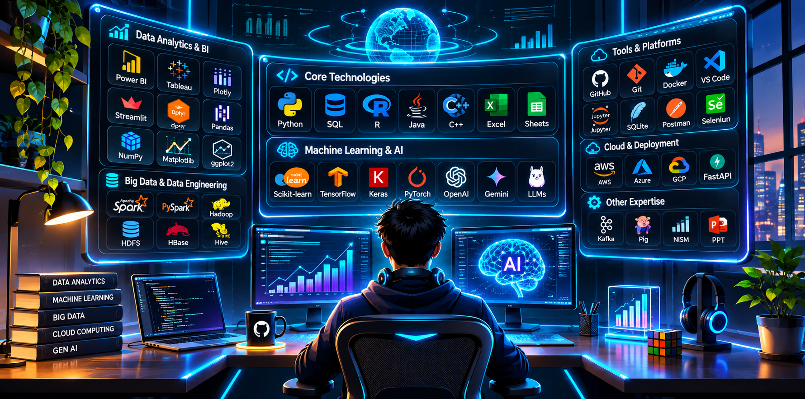

<!-- ================= HERO IMAGE ================= -->

 

# HARDIK PETKAR

### DATA ANALYST · AI ENTHUSIAST · DATA SCIENCE

📍 Mumbai, India

---

<!-- ================= TECHNOLOGY STACK ================= -->

## ⚡ TECH ARSENAL

*Technologies and tools I work with*

### 💻 Programming & Databases

### 📊 Data Analytics & Visualization

### 🤖 Machine Learning & AI

### 🗄️ Big Data & Data Engineering

### ⚙️ Development & Automation

---

<!-- ================= INTERACTIVE PROJECT CATEGORIES ================= -->

## 🧠 AREAS OF INTEREST

*Choose a domain below to explore its projects.*

📊 <b>DATA ANALYTICS</b> — Data exploration, dashboards and insights

 

### 1. E-Commerce Sales Dashboard

**Tech Stack:** Power BI · SQL · Excel

- Interactive sales analytics dashboard.
- Customer and transaction analysis.
- Business KPI tracking and Pareto analysis.
- Dataset involving 986 customers and 1K+ transactions.

🔗 [View GitHub Repository](https://github.com/HardikPetkarDS/Ecommerce-Sales-Dashboard)

### 2. InsightForge AI

**Tech Stack:** Python · Streamlit · Pandas · Plotly · SQLite

- AI-powered data analytics platform.
- Dataset upload, exploration and cleaning.
- Automated visualizations and KPI cards.
- AI-powered analytical insights and report generation.

🔗 [View GitHub Repository](https://github.com/HardikPetkarDS/InsightForge-AI)

### 3. AI Dashboard Generator

**Tech Stack:** Python · Streamlit · Plotly · Pandas

- Converts raw datasets into interactive dashboards.
- Automates data visualization.
- Generates analytical summaries.

### 4. Social Media Big Data Analyzer

**Tech Stack:** Python · Streamlit · Pandas · NLP

- Social media dataset analysis.
- Text analytics and word cloud visualization.
- Exploration of social media data patterns.

📈 <b>BUSINESS INTELLIGENCE</b> — Reporting, KPIs and decision support

 

### 1. E-Commerce Sales Dashboard

**Tech Stack:** Power BI · SQL · Excel

- Sales performance monitoring.
- Customer analysis and segmentation.
- KPI-driven reporting.
- Pareto analysis for business insights.

🔗 [View Repository](https://github.com/HardikPetkarDS/Ecommerce-Sales-Dashboard)

### 2. InsightForge AI

**Tech Stack:** Python · Streamlit · Plotly

- Automated data visualization.
- Interactive analytical dashboards.
- KPI generation and reporting.

🔗 [View Repository](https://github.com/HardikPetkarDS/InsightForge-AI)

💹 <b>FINANCIAL ANALYTICS</b> — Financial technology and portfolio optimization

 

### 1. FINOPT-AI

**AI Wealth Management & Portfolio Optimization System**

**Tech Stack:** Python · Financial Analytics · Portfolio Optimization

- Multi-asset market data analysis.
- Portfolio optimization experiments.
- Curated historical market dataset covering 2021–2025.

### 2. FIN-AI

**Financial AI Application**

**Tech Stack:** FastAPI · React · PostgreSQL · Redis · Twelve Data

- Financial application architecture.
- Market data integration.
- Backend API and frontend integration.
- Financial data processing workflows.

### 3. Stock Market Simulator

**Tech Stack:** Python · Streamlit · Pandas · Plotly

- Interactive financial dashboard.
- Stock market data visualization.
- Financial performance analysis.

🤖 <b>MACHINE LEARNING</b> — Predictive modelling and deep learning

 

### 1. CIFAR-100 Image Classification

**Tech Stack:** Python · TensorFlow · Keras

- Image classification using CIFAR-100.
- Deep learning model development.
- Multi-class image recognition.

### 2. Regression Experiments

**Tech Stack:** Python · Pandas · Scikit-learn

- Linear regression experiments.
- Ridge and Lasso regularization.
- Predictive modelling and evaluation.

### 3. Diabetes & Titanic Analysis

**Tech Stack:** Python · Pandas · Scikit-learn

- Dataset preprocessing.
- Exploratory data analysis.
- Feature preparation and predictive modelling experiments.

### 4. Machine Learning Experiments

**Topics:** K-Means · Naive Bayes · SVM · PCA · Decision Trees · Ensemble Learning

- Classification and clustering experiments.
- Feature reduction and model evaluation.
- Cross-validation and model comparison.

✨ <b>GENERATIVE AI</b> — Intelligent applications and AI-powered solutions

 

### 1. InsightForge AI

**Tech Stack:** Python · Streamlit · Gemini AI · Plotly · SQLite

- AI-powered analytical insights.
- Natural-language assistance for data exploration.
- Automated analytical reporting.

🔗 [View Repository](https://github.com/HardikPetkarDS/InsightForge-AI)

### 2. AI Mirror & AI Lens Mirror

**Tech Stack:** FastAPI · Next.js · MediaPipe · SQLite

- AI-assisted virtual try-on experiments.
- Face landmark and pose detection.
- Body measurement and sizing engine.
- Computer vision-based applications.

### 3. Generative AI Experiments

**Tech Stack:** Python · Gemini API

- AI-powered application prototypes.
- Intelligent chatbot experiments.
- LLM-based workflows.

⚙️ <b>AUTOMATION & APPLICATION DEVELOPMENT</b> — Workflow automation and software applications

 

### 1. CMS DMS Automation

**Tech Stack:** Python · Selenium · Excel · Dropbox

- Excel-driven document workflows.
- Automated browser interactions.
- File management and portal upload automation.

### 2. TASK NEXUS

**Intelligent Employee Task Allocation & Workforce Management System**

**Tech Stack:** Python · Flask

- Employee task allocation.
- Workforce management workflows.
- Task organization and tracking.

### 3. AI Mirror

**Tech Stack:** FastAPI · Next.js · SQLite

- Backend and frontend integration.
- Computer vision application workflows.
- Measurement and sizing components.

🗄️ <b>BIG DATA & DATA ENGINEERING</b> — Distributed processing and data technologies

 

### 1. Apache Pig Analytics

**Tech Stack:** Apache Pig · Hadoop · HDFS

- Data transformation using Pig.
- Big Data analytics workflows.
- Hadoop ecosystem experimentation.

### 2. Hadoop Ecosystem Experiments

**Technologies:** Hadoop · HDFS · HBase · Hive · Spark · PySpark · Kafka

- Distributed data processing.
- Big Data storage and architecture.
- Data transformation and processing experiments.
- Streaming and data engineering concepts.

### 3. Social Media Big Data Analyzer

**Tech Stack:** Python · Pandas · Streamlit

- Social media dataset exploration.
- Large-scale data analysis concepts.
- Text analytics and visualization.

---

<!-- ================= CONTACT ================= -->

## 🤝 LET'S CONNECT

*Open to learning, collaboration and opportunities in Data Analytics and AI.*

  

BUILD · ANALYZE · INNOVATE · REPEAT

